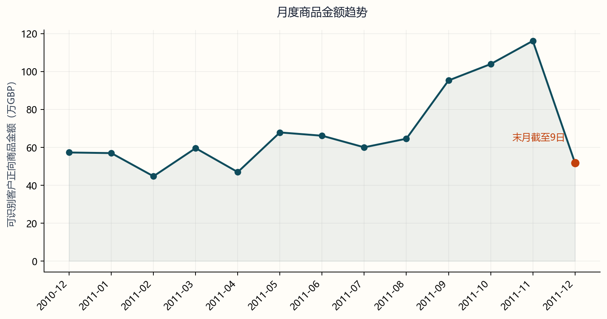
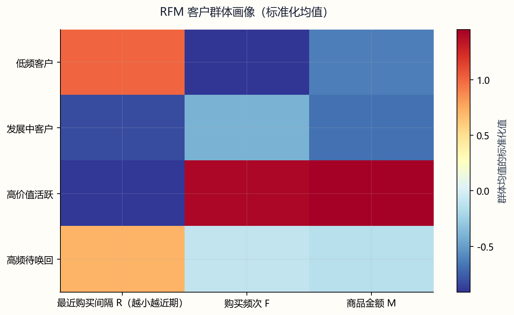
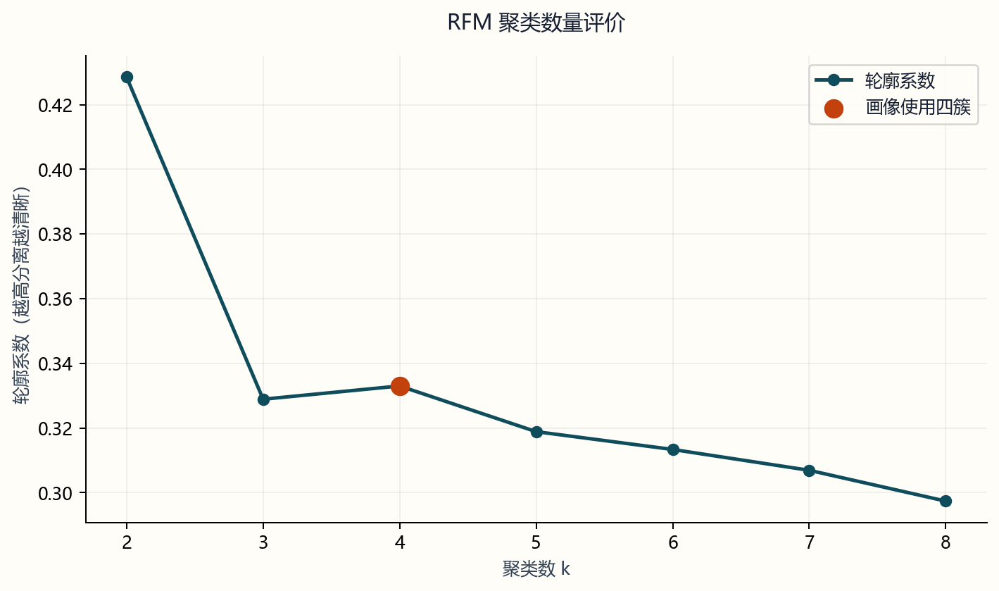
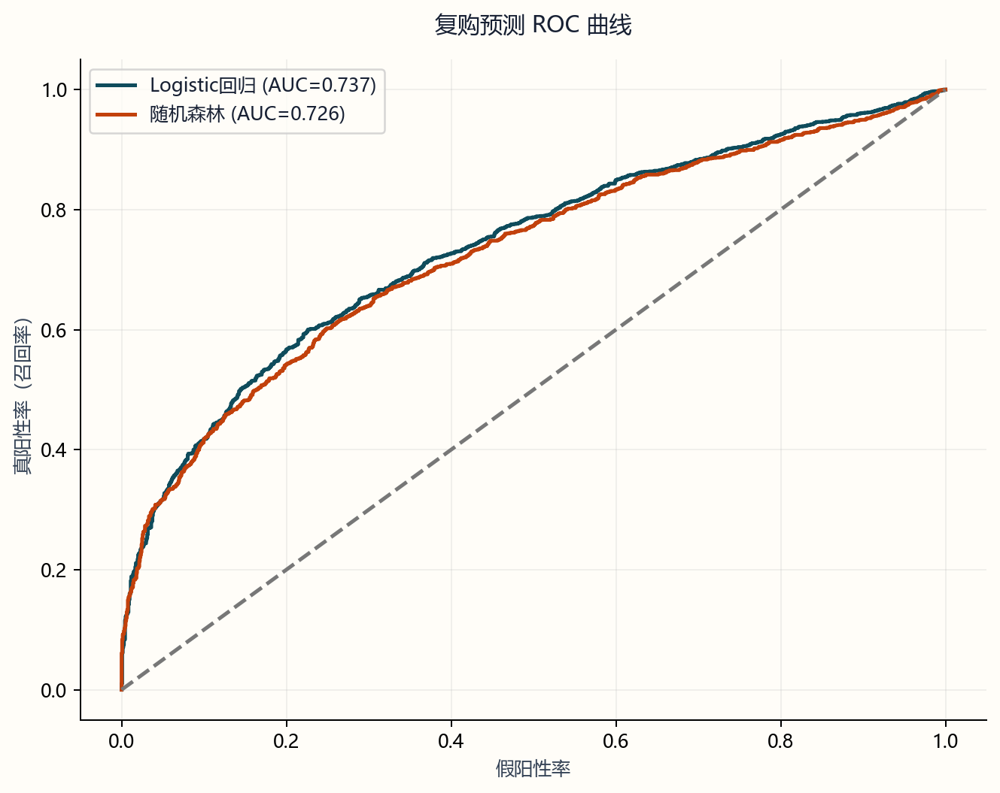

# 电商客户分群与复购预测

使用 UCI Online Retail 交易数据，分析客户的购买频次、最近购买时间和历史金额，再比较 RFM 规则分层与 K-Means 聚类。预测部分使用截止日前的 RFM，判断客户在随后三个月是否再次购买，并比较逻辑回归与随机森林。

项目使用 Python、SQLite 和 scikit-learn，结果通过离线 HTML 报告展示。当前文件夹包含独立的运行入口、SQL、数据、依赖和论文材料。

## 实验结果

分析结果保存在 `outputs/`。原始数据有 541,909 行交易，时间为 2010-12-01 至 2011-12-09。筛除缺失客户编号、取消发票、非正数量和非正单价后，保留 397,884 行、4,338 名客户，正向商品金额为 8,911,407.90 英镑。

### 模型比较

| 模型 | 测试集 ROC-AUC | 测试集 AP | 测试集查准率 | 测试集召回率 | 测试集 F1 |
| :--- | ---: | ---: | ---: | ---: | ---: |
| 逻辑回归 | **0.7368** | **0.8019** | 0.7765 | 0.5922 | 0.6719 |
| 随机森林 | 0.7262 | 0.7968 | 0.7526 | 0.6082 | 0.6728 |

训练集有 2,718 名客户，复购率为 49.63%；测试集有 3,317 名客户，复购率为 56.41%。查准率、召回率和 F1 使用固定阈值 `0.5`。CSV 中的 `pr_auc` 由 `average_precision_score` 计算，表中统一记为平均精度 AP。

逻辑回归在这次时间切分中的 ROC-AUC 和 AP 略高，两个模型的 F1 接近。尚未估计模型差异区间，因此这里只比较数值，不判断差异是否显著。

### 客户分群与名单规模

| RFM 客户群 | 客户数 | 平均距上次购买天数 | 平均发票数 | 平均商品金额（英镑） |
| :--- | ---: | ---: | ---: | ---: |
| 低频客户 | 2,169 | 136.65 | 1.31 | 585.11 |
| 发展中客户 | 199 | 20.80 | 3.06 | 462.70 |
| 高价值活跃 | 1,314 | 16.45 | 9.39 | 4,942.89 |
| 高频待唤回 | 656 | 117.69 | 4.17 | 1,608.64 |

高价值活跃群占客户数约 30.3%，贡献约 72.9% 的客户样本正向商品金额。分群规则本身包含金额得分，这个占比描述历史贡献，不等于未来复购能力。

同一批测试客户中，逻辑回归阈值从 `0.5` 降到 `0.3`，入选人数从 1,427 人增至 2,500 人，召回率从 59.22% 提高到 85.78%，查准率从 77.65% 降到 64.20%。名单扩大后能覆盖更多复购客户，也会选入更多未复购客户。

## 报告图表

完整报告见 [结果报告](outputs/结果报告.html)。用浏览器打开本地文件即可阅读，页面包含交易清洗、客户画像、聚类评价、预测曲线和结果表下载。

### 月度交易变化



图中金额来自清洗后的客户交易。2011 年 12 月只记录到 9 日，报告将其单独标记，不能与完整月份直接比较增长率。

### 客户群画像



热图比较各群的最近购买时间、频次和金额差异，具体均值见上表。规则群用于描述购买行为，不直接表示客户的真实价值或营销响应。

### 聚类评价



候选簇数为 `2` 至 `8`。两簇的抽样轮廓系数约为 0.4285，四簇约为 0.3330；四簇用于进一步观察客户差异，并非轮廓系数最优的选择。

### 复购预测



曲线使用后一个时间窗口的客户标签。完整报告还包含 PR 曲线及不同阈值下的名单比例、查准率和召回率，方便比较覆盖人数与命中比例。

## 运行项目

以下命令均在本项目根目录执行。项目已在 Python 3.10 环境运行，依赖版本见 `requirements.txt`。

### 先查看分析报告

双击 `outputs/结果报告.html`，选择浏览器打开。图表和样式已内嵌，查看报告无需安装 Python；页面中的 CSV 下载需要保留同目录的结果文件。

需要重新生成报告时，先安装依赖：

```bash
python -m pip install -r requirements.txt
```

然后运行：

```bash
python report.py
```

程序核对已有 CSV，重绘经营图表并覆盖生成 HTML，不重新执行 SQL 或训练模型。

### 用原始数据重新运行

原始数据位于 `data/raw/online_retail.zip`。文件缺失时，从 [UCI Online Retail](https://archive.ics.uci.edu/dataset/352/online+retail) 下载压缩包，并以此文件名放入 `data/raw/`。

```bash
python run.py
```

程序读取 ZIP 内的 Excel，完成清洗、SQL 汇总、RFM、聚类和复购预测，随后生成报告。随机种子为 `42`。完整运行会覆盖 `outputs/` 和 `data/processed/` 中的同名文件；需要保留旧结果时，先另行备份。

### 在 PyCharm 中运行

将当前文件夹作为项目打开，选择已安装依赖的 Python 解释器。右键运行 `run.py`，工作目录设为本项目根目录。只更新报告时运行 `report.py`。输入和输出路径按脚本所在目录解析。

## 部署到 GitHub Pages

本项目单独作为一个 GitHub 仓库上传。`.gitignore` 保留代码、SQL、依赖、README、HTML、CSV 和展示图片；原始数据、处理数据、论文、数据库、编辑器配置和 Python 缓存留在本机。克隆后的仓库可以直接查看报告，重新分析时按上文补齐原始 ZIP。

### 首次上传与发布

1. 在 GitHub Desktop 中添加当前项目文件夹。如果尚未创建 Git 仓库，选择 **create a repository here**，将仓库建在当前项目目录。
2. 查看 Changes，确认包含 `.gitignore`、`.github/workflows/pages.yml`、代码和 `outputs/` 中的报告、CSV、PNG，提交后点击 **Publish repository**。需要公开访问时取消 **Keep this code private**。
3. 打开 GitHub 仓库的 **Settings → Pages**，将 **Source** 设为 **GitHub Actions**。
4. 在 **Actions** 页面选择“发布分析报告”，点击 **Run workflow**。发布成功后，在 **Settings → Pages** 查看访问网址。

工作流把 `outputs/结果报告.html` 复制为站点的 `index.html`，同时发布同目录的 CSV。图表已内嵌，静态站点无需 SQLite、原始交易或 Python 环境。

### 后续更新

在本机重新生成报告后，用 GitHub Desktop 提交变更，再点击 **Push origin**。推送到 `main` 或 `master` 会自动更新网页，也可在 Actions 页面手动重新发布。云端只发布已有文件，不执行 SQL 或训练模型。

`.gitignore` 仅影响未跟踪文件，GitHub 网页拖拽上传也不会读取忽略规则。如果之前已经提交过数据或论文，需要另行取消这些文件的版本跟踪。首次上传建议使用 GitHub Desktop 或 Git。

## 分析方法

原始交易写入 SQLite 的 `transactions` 表，SQL 分别汇总月度金额、发票数和客户 RFM。Python 按相同条件计算，程序逐项比较两套结果，不一致时停止运行。顺序清洗记录保留行数和带符号金额，独立标记则记录各规则命中的交易。

RFM 分析日为 `2011-12-10`。R 是距最近购买的天数，F 是去重发票数，M 是正向商品金额。规则分层将三个指标按排名分为四档，R 的评分方向与 F、M 相反；并列值使用 `rank(method='first')`，因此同值客户的分档受当前行序影响。

K-Means 使用经过 `log1p` 和标准化的 RFM，`n_init=20`。不同簇数的轮廓系数最多抽取 1,500 名客户计算，抽样种子为 `42`。固定四簇后，导出群体均值及其与规则分层的交叉表。

### 复购观察窗口

| 样本 | 特征使用的交易 | 标签窗口 | 客户数 |
| :--- | :--- | :--- | ---: |
| 训练集 | 2011-06-01 之前 | 2011-06-01 至 2011-09-01，不含结束日 | 2,718 |
| 测试集 | 2011-09-01 之前 | 2011-09-01 至 2011-12-01，不含结束日 | 3,317 |

每个标签窗口中至少出现一次符合清洗条件的购买，记为复购。客户须在对应特征截止日前有购买历史。两个窗口可以包含同一客户，检验的是已有客户在后续时期的购买，而不是对全新客户的泛化。

预测直接使用原始尺度的 RFM，不沿用聚类的 `log1p` 变换。缺失值中位数填补仅在训练集拟合；逻辑回归另用训练集参数标准化，测试集沿用。逻辑回归使用 `class_weight='balanced'`；随机森林使用 300 棵树、最小叶节点 5 条样本及 `balanced_subsample` 类别权重。

### 指标定义

| 指标 | 计算与范围 |
| :--- | :--- |
| 正向商品金额 | 符合清洗条件的数量 × 单价之和，单位为英镑 |
| 复购率 | 标签窗口内至少购买一次的历史客户数 ÷ 该窗口样本客户数 |
| ROC-AUC | 复购客户得分高于未复购客户的区分能力，同分按一半计入 |
| AP | 按召回率增量加权的查准率平均值 |
| 查准率 | 入选客户中的实际复购人数 ÷ 入选人数 |
| 召回率 | 入选客户中的实际复购人数 ÷ 全部实际复购人数 |
| F1 | 查准率与召回率的调和平均数 |
| 入选比例 | 达到指定分数阈值的客户数 ÷ 测试客户数 |
| 轮廓系数 | 比较样本与本簇、最近其他簇的距离，越高表示分离越清晰 |

## 文件说明

| 文件 | 用途 |
| :--- | :--- |
| `run.py` | 清洗交易、执行 SQL、客户分群和复购预测 |
| `report.py` | 核对已有结果、绘制经营图表并生成离线 HTML |
| `sql/retail_analysis.sql` | 月度交易和客户 RFM 汇总 |
| `requirements.txt` | Python 依赖及固定版本 |
| `.gitignore` | 上传时排除本机数据、论文、环境和缓存 |
| `.github/workflows/pages.yml` | 将 HTML 和 CSV 自动发布到 GitHub Pages |
| `data/raw/online_retail.zip` | 原始交易数据 |
| `data/processed/online_retail.csv` | 可重新生成的交易中间文件 |
| `论文材料/` | 修订版 Word、课程模板及历史文稿 |

分析结果保存在 `outputs/`：

| 输出文件 | 内容 |
| :--- | :--- |
| `结果报告.html` | 可离线阅读的完整报告 |
| `summary.csv` | 样本规模、金额口径、时间窗口和 SQL 对账状态 |
| `cleaning_reconciliation.csv`、`cleaning_flags.csv` | 顺序清洗对账与各规则独立命中统计 |
| `monthly_sales.csv` | 客户样本月度金额、发票数和客户数 |
| `customer_rfm.csv`、`rfm_segments.csv` | 客户 RFM、评分、分群及规则群均值 |
| `kmeans_segments.csv`、`rfm_cluster_crosstab.csv`、`cluster_k_evaluation.csv` | 聚类均值、交叉表及候选簇数评价 |
| `repurchase_metrics.csv`、`repurchase_thresholds.csv` | 模型评价与阈值比较 |
| `retail.sqlite` | 交易数据库，供 SQL 汇总与复核 |
| `monthly_sales.png`、`rfm_profile.png`、`rfm_segments.png` | 月度交易和客户群图表 |
| `cluster_k_evaluation.png`、`repurchase_roc.png`、`repurchase_pr.png` | 聚类评价和复购预测曲线 |

## 结果检查

```bash
python run.py --check
```

该命令检查已有输出中的人数、金额、指标和窗口关系，并重新生成经营图表与 HTML。SQL 与 Python 的逐项对账在完整运行时执行；`--check` 读取已保存的对账状态，不重新查询数据库或训练模型。

## 数据限制

客户分析排除了缺失 CustomerID 的交易。客户样本正向商品金额为 8,911,407.90 英镑，原始数据中全部正数量、正单价交易合计为 10,666,684.54 英镑，客户样本覆盖约 83.54%。清洗剔除了取消和负数量记录，但没有逐笔匹配退货与原发票，金额不能解释为净销售额、收入或利润。

清洗标记可以重叠，命中行数不能相加得到总删除数。2011 年 12 月交易不完整，但测试标签在 12 月 1 日结束，早于数据终点，因此本次标签没有被末月直接截断。

预测只检验一次时间切分，且两个特征窗口的历史长度不同。模型没有概率校准，使用类别权重后更不宜直接把分数解释为真实复购概率。客户群和预测标签都描述历史记录，项目没有营销干预实验，无法从名单命中率推算触达收益。

## 数据与参考

- [UCI Online Retail](https://archive.ics.uci.edu/dataset/352/online+retail)：原始数据和字段说明。
- [Chen、Sain 与 Guo（2012）](https://doi.org/10.1057/dbm.2012.17)：使用同类零售数据进行 RFM 客户分群的案例。
- [scikit-learn K-Means](https://scikit-learn.org/stable/modules/clustering.html#k-means)：聚类方法与参数说明。
- [scikit-learn 模型评价](https://scikit-learn.org/stable/modules/model_evaluation.html)：ROC-AUC、AP 和分类指标说明。
